# ngPolandConfApp

The official app of the **NG Poland**, **JS Poland** and **AI Poland** conferences, built with Flutter 🚀

One app covers the whole conference week in Warsaw: two hands-on workshop days and three conference days. It has the full agenda for every track, speaker profiles, workshop details, live voting for the best talks and practical info about the venue.

## Download

- Android: https://play.google.com/store/apps/details?id=com.mvpgreenhouse.ng_poland_conf_app
- iOS: https://apps.apple.com/pl/app/ngpolandconfapp/id6470946758
- macOS: https://apps.apple.com/pl/app/ngpolandconfapp/id6470946758
- Web: https://ngpolandconfapp.web.app/

## Features

- **Home**: a countdown to the conference and the days of the conference week (workshops, NG Poland, JS Poland, AI Poland).
- **Schedule**: the agenda for each conference, switched from the bottom bar, shown in Warsaw time with the live state of the conference.
- **Talk details**: the description, time slot and speakers of every session.
- **Live voting & Top 5**: vote for your favourite talks during the conference and watch the Top 5 ranking update live.
- **Workshops**: the hands-on and AI workshop days with level, trainer, key takeaways and a full description.
- **Speakers**: every speaker with their bio, social links and talks.
- **Q&A**: ask the speakers questions during the conference.
- **Info**: the venue with a Google Maps link, tickets and the dates of every event.
- **About**: the conferences, the app's authors and a link to this repository.
- **Account**: sign in with Google, Apple or an email magic link, and delete your account from the app.
- **Dark & light mode**, plus cached content so the app keeps working with a weak connection.
- **Admin panel** for organisers to open and close voting.

## Screenshots

<table>
  <tr>
    <td>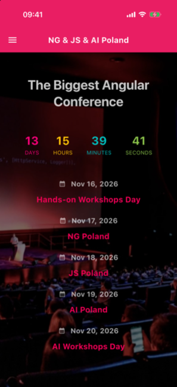</td>
    <td>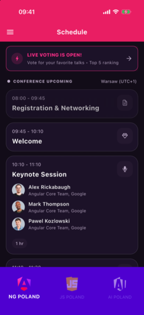</td>
    <td>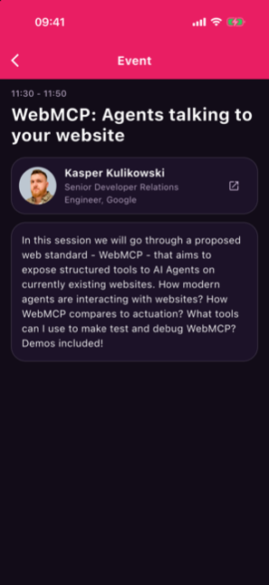</td>
    <td>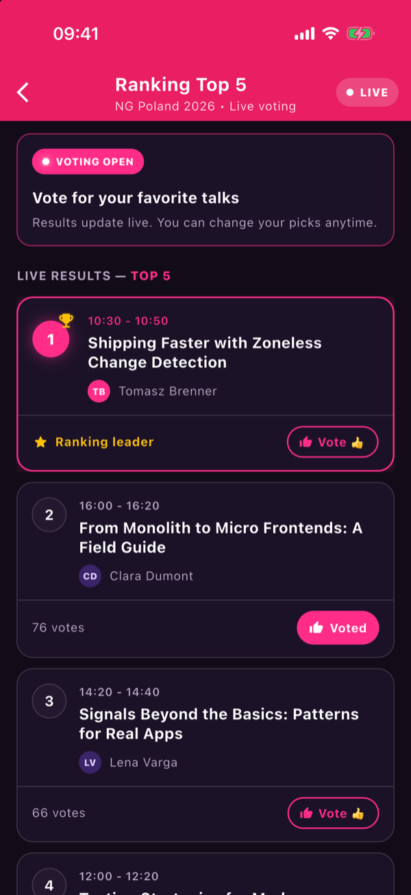</td>
  </tr>
  <tr>
    <td>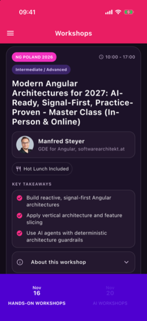</td>
    <td>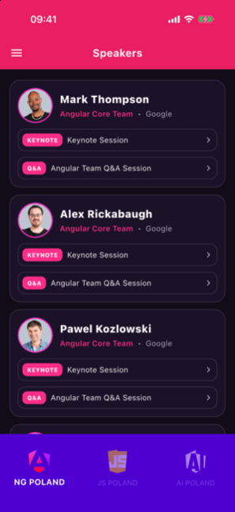</td>
    <td>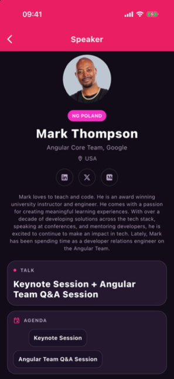</td>
    <td>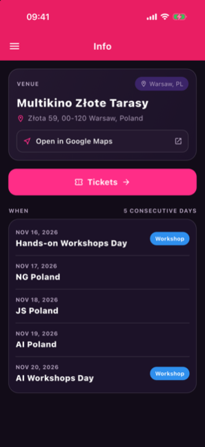</td>
  </tr>
  <tr>
    <td>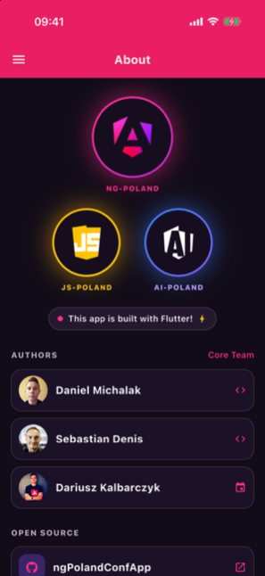</td>
    <td>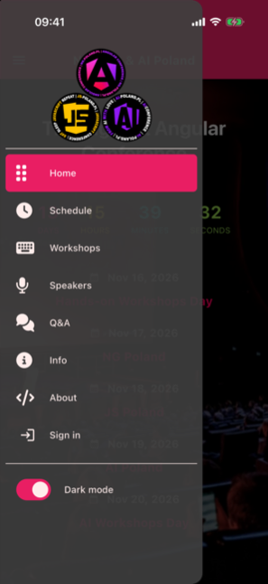</td>
    <td>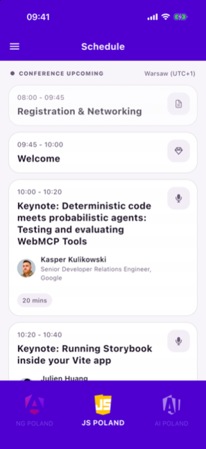</td>
    <td>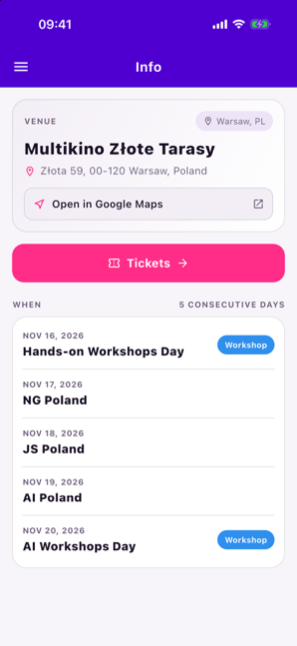</td>
  </tr>
</table>

## Tech stack

Flutter (Android, iOS, macOS, web), Firebase (Auth, Firestore, Hosting), `flutter_bloc`, `go_router`, `get_it` + `injectable`, `freezed` and Hive for the offline cache. The code follows a feature-first clean architecture. Setup, architecture and coding conventions are described in [ng_poland_conf_app/README.md](ng_poland_conf_app/README.md).

## Contributing

If you would like to help us, you're welcome. There will always be something you can work on, and [WISHLIST.md](WISHLIST.md) has some ideas.
